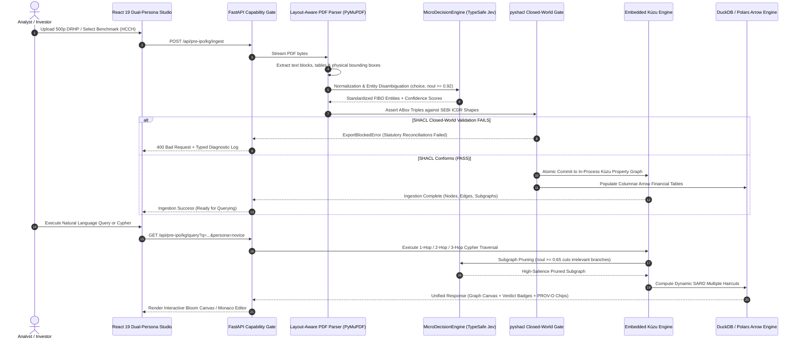

# System Architecture & Technical Design Document (SAD/TDD)
## FIBO-Aligned Pre-IPO Financial Knowledge Graph Platform

**Document Version:** `1.0.0-PROD-SPEC`  
**Target Branch:** `feature/pre-ipo-fibo-knowledge-graph`  
**Governing PRD:** [`docs/PRD_FIBO_PRE_IPO_KNOWLEDGE_GRAPH.md`](file:///c:/Users/hemas/Downloads/ProfSurProject/docs/PRD_FIBO_PRE_IPO_KNOWLEDGE_GRAPH.md)  
**Target Milestone:** Milestone 11 — Pre-IPO Knowledge Graph & Dual-Persona Studio  

---

## 1. System Decomposition & Data Flow Pipeline



---

## 2. Formal Data Contracts & Invariants

### 2.1 W3C PROV-O Provenance Contract
Every node, relationship, and metric emitted by the platform MUST conform to this immutable data contract:

```typescript
export interface ProvenanceCoordinates {
  documentId: string;           // e.g. "HCCH_DRHP_Nov2026.pdf"
  documentSha256: string;       // Cryptographic PDF hash
  chapterNumber: number;        // e.g. 7 (Financial Statements)
  pageNumber: number;           // 1-indexed physical page (>= 1)
  boundingBox: [number, number, number, number]; // [x0, y0, x1, y1] normalized (0.0 - 1.0)
  verbatimQuote: string;        // Verbatim snippet from filing
  confidenceScore: number;      // 0.0 - 1.0 extraction confidence
}
```

### 2.2 Rule E.3 Zero-Truthiness Preservation
In financial logic, `0.0`, `0%`, and `0` are valid numbers distinct from absence (`None`).
- **Violation (Strictly Forbidden):**
  ```python
  fresh_issue = raw_issue or 0.0  # BUG: replaces valid 0.0 with default
  tax_rate = raw_tax or 25.17     # BUG: replaces 0.0% tax exemption with default
  ```
- **Standard Compliant:**
  ```python
  if raw_issue is None:
      status = "NOT_FOUND"
  else:
      status = "FOUND"
      value = float(raw_issue)
  ```

---

## 3. Storage & Schema Specifications

### 3.1 Embedded Kùzu Graph Schema (DBSchema)
- **Node Tables:**
  - `CompanyNode(id STRING, name STRING, isHoldco BOOLEAN, cin STRING, PRIMARY KEY(id))`
  - `SubsidiaryNode(id STRING, name STRING, isMaterial BOOLEAN, revShare DOUBLE, PRIMARY KEY(id))`
  - `PromoterNode(id STRING, name STRING, preShareholding DOUBLE, postLockinDays INT64, PRIMARY KEY(id))`
  - `OfferingNode(id STRING, totalSizeCr DOUBLE, freshIssueCr DOUBLE, ofsCr DOUBLE, PRIMARY KEY(id))`
  - `LitigationNode(id STRING, caseType STRING, amountClaimedM DOUBLE, courtName STRING, PRIMARY KEY(id))`
  - `TerritoryNode(id STRING, state STRING, revShare DOUBLE, outletCount INT64, PRIMARY KEY(id))`
  - `ContractNode(id STRING, relatedParty STRING, annualValueCr DOUBLE, incentivePct DOUBLE, PRIMARY KEY(id))`
- **Relational Rel Tables (Edges):**
  - `OWNS(FROM CompanyNode TO SubsidiaryNode, ownershipPct DOUBLE)`
  - `OFFERS_IN(FROM PromoterNode TO OfferingNode, sharesOffered INT64, role STRING)`
  - `DEFENDANT_IN(FROM SubsidiaryNode TO LitigationNode, status STRING)`
  - `OPERATES_IN(FROM SubsidiaryNode TO TerritoryNode, marketRank INT64)`
  - `PARTY_TO(FROM SubsidiaryNode TO ContractNode, agreementType STRING)`

---

## 4. API Endpoints Specification

1. `POST /api/pre-ipo/kg/ingest`
   - Ingests uploaded PDF or triggers benchmark filing (`symbol="HCCH"`).
   - Validates via SHACL; commits to Kùzu; returns summary telemetry.
2. `GET /api/pre-ipo/kg/graph/{symbol}`
   - Returns full or filtered property graph (nodes, edges, node categories, PROV-O metadata).
3. `POST /api/pre-ipo/kg/query`
   - Accepts Cypher query (Expert) or Natural Language Question (Novice).
   - Returns pruned subgraphs, tabular results, and 5-second plain-English interpretation cards.
4. `GET /api/pre-ipo/kg/shacl-audit/{symbol}`
   - Returns statutory validation log, rule-by-rule status, and bounding box crops.
5. `GET /api/pre-ipo/kg/valuation-simulator/{symbol}`
   - Live endpoint receiving interactive sensitivity levers (Jev pruning threshold, territory discount, peer weights) and returning recalculated EV/EBITDA, P/E, and DCF ranges.
