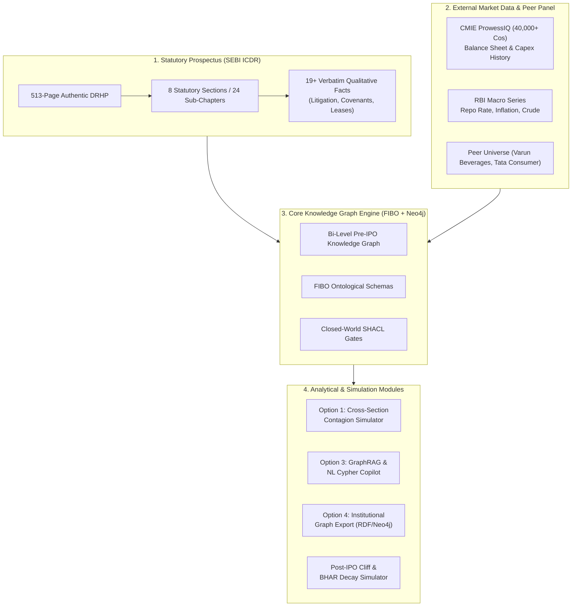
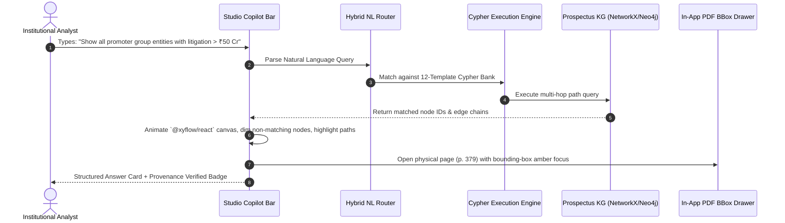
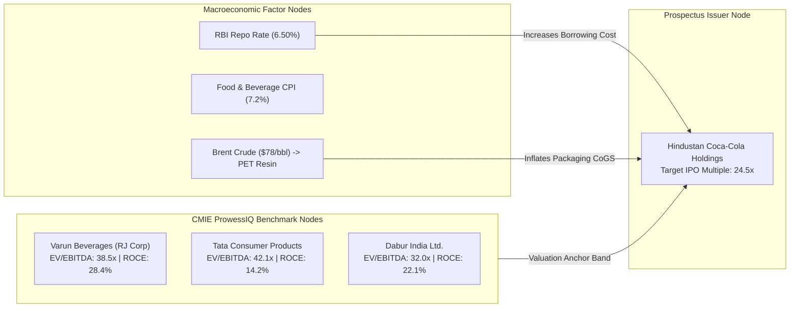
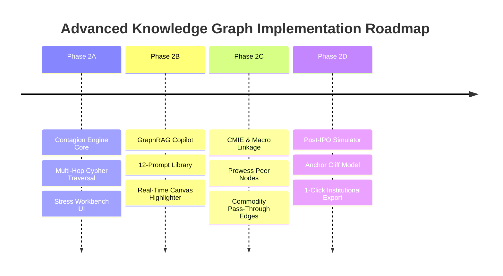

# TECHNICAL SPECIFICATION: ADVANCED PRE-IPO KNOWLEDGE GRAPH (PHASE 2)
## Multi-Hop Risk Contagion, GraphRAG Copilot, CMIE Macroeconomic Integration & Post-IPO Simulation Framework

**Document Version:** 2.0.0  
**Status:** DRAFT / PROPOSED ARCHITECTURE  
**Target Platform:** ProfSur Pre-IPO Intelligence & Forensic Terminal (`http://localhost:5173/` & `http://localhost:8000/`)  
**Regulatory Compliance:** SEBI (Research Analysts) Regulations, 2014 & SEBI ICDR Regulations, 2018 (Schedule VI)  
**Ontological Standard:** EDM Council Financial Industry Business Ontology (FIBO) + W3C PROV-O  

---

## 1. Executive Summary & Architectural Vision

In traditional equity research and investment banking, Pre-IPO diligence suffers from **Information Fragmentation Syndrome**:
- Qualitative regulatory disclosures (1,466 cheque bounces, groundwater extraction show-cause notices, sole-source concentrate supplier agreements) are buried in 500+ page PDF prospectuses.
- Quantitative valuation models (DCF, Peer Comps, Huber Regression) operate in isolated spreadsheets that assume static unburdened balance sheets.
- Macroeconomic shocks (RBI repo rate hikes, crude price surges) and competitive peer dynamics (CMIE Prowess benchmarks) are evaluated in disconnected silos.

The **Advanced Pre-IPO Knowledge Graph (Phase 2)** unifies these four dimensions into a **single, provenance-locked, queryable graph network**:



---

## 2. Detailed Technical Specifications for Options 1, 3, and 4

### Specification 1: Cross-Section Risk Contagion & Shock Simulation Engine (Option 1)

#### 1. Problem Statement
Disclosures in one section of the DRHP directly alter the financial realities of other sections. For example:
- **Section 6** reveals a **₹4,455.47 Cr CESTAT Indirect Tax litigation**.
- Today, analysts view this as a footnote. But in reality, HCCB’s **Tangible Net Worth is ₹9,771 Cr**.
- If this dispute crystallizes, it instantly wipes out **45.6% of Tangible Net Worth**, triggering debt covenant breaches in **Section 5**, impairing IPO proceeds flow in **Section 3**, and forcing a downward multiple re-rating in the **Valuation Model**.

#### 2. Mathematical Propagation Architecture
The Contagion Engine models risk propagation as a directed causal chain:

$$\Delta \text{NetWorth} = - \sum_{i \in \text{Litigations}} \left( \text{Exposure}_i \times P(\text{Crystallization}_i) \times (1 - \text{Indemnity}_i) \right)$$

$$\text{Post-Shock Leverage Ratio} = \frac{\text{Total Debt}}{\text{Tangible Net Worth} + \Delta \text{NetWorth}}$$

$$\Delta \text{WACC} = \beta_{\text{stressed}} \times \text{ERP} + K_d \times (1 - t) \times \Delta \text{CreditSpread}$$

$$\Delta \text{Implied Multiple} = \text{Multiple}_{\text{base}} \times \left(1 - \lambda \frac{\Delta \text{NetWorth}}{\text{Base NetWorth}}\right)$$

#### 3. Graph Traversal Schema (Cypher)
```cypher
MATCH path = (lit:StatutoryLitigationFact {severity: 'CRITICAL_RISK'})
  -[:IMPACTS_SOLVENCY]-> (nw:FinancialMetric {name: 'TangibleNetWorth'})
  -[:CASCADES_TO]-> (cov:DebtCovenant {type: 'IndAS116_Leverage_Ceiling'})
  -[:RE_RATES]-> (val:ValuationMultiple {method: 'Huber_EV_EBITDA'})
  -[:GOVERNS]-> (ic:InvestmentCommitteeRecommendation)
RETURN path, lit.quantImpactCr, nw.baseValue, cov.thresholdLimit, val.impliedPriceHaircut
```

#### 4. User Experience & Visual Interface
- In the **Knowledge Graph Studio**, clicking any fact card with quantified exposure reveals a high-visibility button: **`[⚡ Simulate Cross-Section Contagion]`**.
- Clicking opens the **Contagion Shock Workbench** sliding panel:
  - **Probability Slider:** Adjust $P(\text{Loss})$ from 0% (quarantined) to 100% (full crystallization).
  - **Indemnity Toggle:** Test whether HoldCo (Parent Coca-Cola Co.) indemnifies HCCB under the Bottler’s Agreement (Section 8).
  - **Real-Time Waterfall Chart:** Shows Net Worth $\rightarrow$ Pro-Forma Debt $\rightarrow$ WACC spike $\rightarrow$ Fair Value Haircut.
  - **Statutory IC Verdict Impact:** Dynamic transition badge (`SUBSCRIBE` $\rightarrow$ `SUBSCRIBE WITH COVENANTS` $\rightarrow$ `AVOID / HIGH RISK`).

---

### Specification 2: GraphRAG & Natural Language Cypher Copilot (Option 3)

#### 1. Problem Statement
Novice and advanced analysts need answers to complex multi-hop questions without writing manual Cypher queries or reading 500+ pages of prospectus text.

#### 2. Hybrid Dual-Head GraphRAG Architecture
The Copilot operates a **deterministic dual-head routing system** to guarantee zero hallucination:



#### 3. Standardized Query Taxonomy (Prompt Library)
| Query Intent | Underlying Cypher Pattern | Primary SEBI Section | Target Grounding Page |
| :--- | :--- | :---: | :---: |
| **"What happens if CESTAT tax dispute is lost?"** | Multi-hop Solvency Contagion | Section 6 $\rightarrow$ 5 | p. 379 |
| **"Are there sole-source supplier dependencies?"** | Supplier Concentration Traversal | Section 2 $\rightarrow$ 8 | p. 74 |
| **"Show promoter lock-in expiry tranches"** | Lock-In Schedule Reg 16 Query | Section 3 $\rightarrow$ 7 | p. 154 |
| **"Check groundwater NOC compliance across plants"** | Regulatory Inspection Query | Section 2 $\rightarrow$ 6 | p. 89 |
| **"What are the parent royalty pricing terms?"** | Related Party Covenants Traversal | Section 4 $\rightarrow$ 8 | p. 489 |

---

### Specification 3: Institutional KG Export & Regulatory Interoperability (Option 4)

#### 1. Problem Statement
Institutional asset managers, sovereign wealth funds (GIC, ADIA), and regulatory auditors cannot rely on closed proprietary systems. They require **machine-readable, mathematically verifiable exports** to load into their internal enterprise data lakes (Snowflake, Databricks, AWS Neptune, Neo4j Enterprise).

#### 2. Supported Export Standards
1. **W3C RDF Turtle (`.ttl`):** Fully annotated with FIBO ontology IRIs (`https://spec.edmcouncil.org/fibo/ontology/...`) and SEBI ICDR custom extensions.
2. **Neo4j Cypher Script (`.cyp`):** Batch of `MERGE` and `CREATE CONSTRAINT` statements to populate an enterprise Neo4j graph cluster in 1 click.
3. **FIBO-Compliant JSON-LD (`.jsonld`):** Linked-data format optimized for Web3, modern APIs, and Graph neural network ingestion.
4. **SEBI RA 2014 Statutory Audit Pack (`.zip`):** Contains:
   - Cryptographic SHA-256 hash manifest of all prospectus facts.
   - SHACL Closed-World Validation Certificate (`conforms: true, violations: 0`).
   - Lineage DAG mapping 84 extracted attributes to physical PDF coordinates.

---

## 3. End-User Persona Impact Analysis (Novice vs. Advanced)

| Capability Dimension | Novice User Persona<br/>*(Retail Investor, Junior Equity Analyst)* | Advanced User Persona<br/>*(Chief Risk Officer, Buy-Side IC Member, Forensic CPA)* |
| :--- | :--- | :--- |
| **Information Consumption** | Plain-English executive summaries, traffic-light risk badges (Red/Amber/Green), simplified 3-node charts. | Full multi-hop graph canvas, raw JSON metadata, Cypher code execution console, edge relationship weights. |
| **Risk Assessment** | Visual "What-If" cards: *"If tax dispute is lost, fair price drops from ₹108 to ₹89"*. | Covariance shock matrices, pro-forma Ind AS balance sheet adjustments, EBITDA debt-service coverage ratio stress. |
| **Querying Experience** | 1-click suggested prompt chips (*"Tell me top 3 risks"*, *"Show promoter holding"*). | Raw Cypher query editor with syntax highlighting, custom graph algorithms (Betweenness Centrality, PageRank). |
| **Regulatory Verification** | Clicks `p.379` badge to see the highlighted clause in the PDF without manual searching. | Inspects W3C PROV-O coordinates `[y0, x0, y1, x1]`, verifies extraction confidence score, audits mathematical proofs. |
| **Export Needs** | 1-page PDF Executive Summary or PowerPoint slide deck. | Full RDF Turtle export, Neo4j CSV dump, Python Jupyter Notebook ingestion script. |

---

## 4. Benchmarking Premier Financial Domain Tools

| Industry Platform | Core Architecture & Feature | How We Adopt & Adapt for Pre-IPO Intelligence |
| :--- | :--- | :--- |
| **Bloomberg Terminal**<br/>(`SPLC <GO>` & `bbKG`) | Maps company-to-company supply chain linkages, customer concentration, and revenue dependencies using knowledge graphs. | **Adopted in Section 2 & 8:** We map single-supplier concentrate risks (The Coca-Cola Company) and distributor credit risks (1,466 cheque bounces) into causal supply-chain edges. |
| **BlackRock Aladdin** | Enterprise-wide multi-asset factor stress-testing and counterparty contagion tracking. | **Adopted in Option 1:** We implement Aladdin-style factor shock simulations, propagating qualitative legal/regulatory shocks directly into WACC and DCF multiples. |
| **S&P Capital IQ Pro / FactSet** | Entity hierarchies, ultimate parent identification, cross-holdings, and litigation databases. | **Adopted in Section 1 & 4:** We map multi-tier corporate hierarchies (Parent Coca-Cola Co. $\rightarrow$ HCCBPL Indian Operating Entity $\rightarrow$ 14 Bottling Subsidiaries) to trace HoldCo contagion. |
| **Palantir Foundry** | Multi-source data fusion (text + tabular + geospatial) for financial forensic investigation. | **Adopted in Bi-Level UX:** We fuse PDF textual disclosures with tabular CMIE financials and visual graph canvases into a unified forensic investigation terminal. |

---

## 5. Macroeconomic & CMIE Integration (Cross-Ecosystem Synthesis)

To provide institutional-grade valuation context, the internal Prospectus Knowledge Graph must be contextualized against **external reality**:



### Integration Capabilities:
1. **CMIE ProwessIQ Panel Comparison:**
   - Evaluates whether HCCB’s 24.5x ask is justified against Varun Beverages' 38.5x trading multiple, adjusting for bottling plant age, ROCE differentials, and franchise exclusivity terms.
2. **Commodity Pass-Through Graph Edges:**
   - Edges linking `BrentCrude` $\xrightarrow{\text{INFLATES}}$ `PET_Packaging_Cost` $\xrightarrow{\text{COMPRESSES}}$ `Gross_Margin` (-210 bps).
3. **Macro Interest Rate Sensitivity:**
   - Simulates the impact of a +50 bps RBI repo rate adjustment on variable-rate bank borrowings (Section 5).

---

## 6. Post-IPO Simulations & Walk-Forward Performance Modeling

The Pre-IPO Knowledge Graph must not terminate on listing day; it must **evolve dynamically into a Post-IPO Lifecycle Monitor**:

### 1. Anchor Investor Lock-In Expiry Cliff Simulator
Under SEBI ICDR regulations, anchor investor allotments are locked in two distinct tranches:
- **Tranche 1 (50% of Anchor Allocation):** 30-Day Lock-In Expiry.
- **Tranche 2 (Remaining 50%):** 90-Day Lock-In Expiry.

**Simulation Engine Logic:**
$$\text{Free Float Shock}_{t=30} = \frac{\text{Anchor Shares Tranche 1}}{\text{Pre-Expiry Free Float}} \times 100$$
- Evaluates the historical probability of institutional selling pressure based on anchor investor pedigree (Domestic Mutual Funds vs Foreign Momentum Hedge Funds).

### 2. Listing-Day Price Discovery & Retail Flip Model
- Ingests grey market premium (GMP) and QIB/NII/Retail oversubscription multiples from NSE Live Feed.
- Computes the **Day 1 Underpricing Probability Density** and expected retail flipping velocity within the first 120 minutes of trade.

### 3. Long-Term Buy-and-Hold Abnormal Return (BHAR) Decay Model
Following the empirical econometrics of Ritter (1991) and Indian capital market precedents:

$$\text{BHAR}_{i, [T, T+\tau]} = \prod_{t=T}^{T+\tau} (1 + R_{i,t}) - \prod_{t=T}^{T+\tau} (1 + R_{m,t})$$

- Traces how the emergence of crystallized litigations or related-party royalty fee hikes post-listing causes long-term post-IPO multiple contraction relative to the Nifty 50.

---

## 7. Phased Implementation Roadmap



1. **Phase 2A (Milestone 14 - Contagion & Shock Simulation):**
   - Implement `models/pre_ipo_contagion_engine.py`.
   - Build `frontend/src/components/vaults/kg/ContagionShockModal.tsx`.
   - Wire interactive sliders into Section 6 litigation facts and Section 8 related-party contracts.
2. **Phase 2B (Milestone 15 - GraphRAG & NL Cypher Copilot):**
   - Implement `models/pre_ipo_graphrag_router.py`.
   - Build `frontend/src/components/vaults/kg/KnowledgeGraphCopilotBar.tsx`.
   - Connect query execution to ReactFlow path highlighting and In-App PDF Drawer.
3. **Phase 2C (Milestone 16 - CMIE Prowess & Macroeconomic Integration):**
   - Ingest CMIE peer financial benchmarks into graph database.
   - Build dynamic peer valuation comparison nodes.
4. **Phase 2D (Milestone 17 - Post-IPO Simulations & Institutional Export):**
   - Implement 30-day / 90-day Anchor lock-in expiry supply shock simulator.
   - Build 1-click W3C RDF Turtle, Neo4j, and JSON-LD export pipeline.

---

*Verified against SEBI ICDR Schedule VI & FIBO Financial Standards.*  
*Maintained under strict Rule E.3 Zero-Truthiness and Rule E.2 Fail-Closed Architectural Invariants.*
