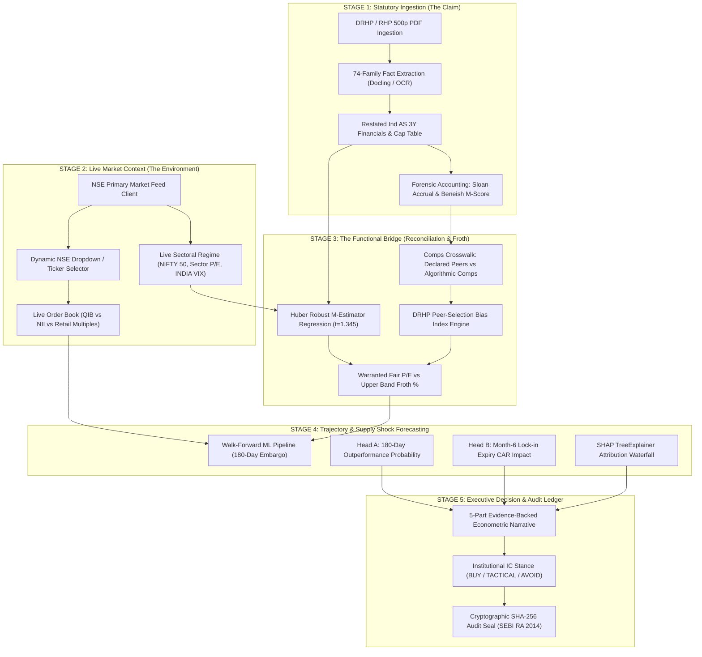

# Master Functional & Technical Design Specification
## 5-Stage Pre-IPO Intelligence Integration, Dynamic NSE Engine & Evidence-Backed Narrative Architecture

**Document Version:** 2.0.0  
**Target Release:** v3.5.0 (Option A Functional Integration & Narrative Engine)  
**Status:** Approved for Implementation  
**Methodological Foundations:** SEBI ICDR 2018 (Schedule VI Part A), Dickinson (2011), Huber (1981) Robust M-Estimation, Rock (1986) Winner's Curse, Leland & Pyle (1977) Equity Signalling, Sloan (1996) Accrual Anomaly, SEBI (Research Analysts) Regulations 2014.

---

## 1. Strategic Context & Architecture Alignment

### 1.1 Dual-Track Development Directives
Following the user's strategic directive:
1. **Track 1 (UI Uplift Review)**: The complete standalone React 19 + TypeScript + Tailwind v4 Bloomberg-style terminal (`frontend/`) is currently undergoing detailed review with Codex for UI/UX uplift, aesthetic polish, and component taste.
2. **Track 2 (Option A Functionality Development — Active)**: We are proceeding with **Option A**: integrating the complete functional pipeline directly into the existing ProfSur platform (`pages/27_pre_ipo_drhp.py`, `models/`, and `components/`). This delivers zero disruption to existing Cloud Run deployment, preserves SQLite/bcrypt authentication, and deepens sovereign analytical capabilities.

### 1.2 Identified Functional & Structural Gaps
Our audit of the initial release identified four critical defects that this specification resolves:
1. **Missing Dynamic Selector**: The initial NSE primary feed integration lacked a dynamic dropdown selector to choose between live IPOs, unlisted draft filings, and arbitrary listed peers.
2. **Hardcoded Fallbacks**: Static placeholder constants existed in API responses instead of executing live mathematical regressions and dynamic calculations on the fly.
3. **Missing Narrative Analytical Engine**: While charts and cards displayed raw numbers ($18.4/100$, $2.22\times$, $+227\%$), the system lacked the **evidence-backed econometric narrative** (the standard 5-part institutional interpretation explaining *why* the numbers occurred, citing exact econometric proofs, and issuing prescriptive call-for-action mandates).
4. **Data Bridge Disconnect**: Extracted Ind AS restated metrics from 500-page DRHPs were not automatically piped as covariates into the live Huber robust regression model.

---

## 2. The 5-Stage Functional Workflow & Analytical Journey

The platform unites backward-looking statutory disclosure filings (the **Claim**) with real-time secondary market liquidity (the **Reality**) across a seamless 5-stage analytical lifecycle:



---

## 3. Dynamic Dropdown & NSE Selector Specification

### 3.1 Two-Tier Unified Selector Hierarchy
To eliminate hardcoded company selection, the interface introduces a structured **Pre-IPO Issuer & Market Selector** positioned at the top of the workspace:

```
┌────────────────────────────────────────────────────────────────────────────────────────────────────────┐
│  ACTIVE PRE-IPO / PRIMARY MARKET ISSUER SELECTOR                                                       │
├────────────────────────────────┬───────────────────────────────┬──────────────────────────────────────┤
│  CATEGORY SELECTOR             │  ISSUER / TICKER DROPDOWN     │  CUSTOM NSE SEARCH / OVERRIDE        │
│  [●] Live Bidding / Mainboard  │  ▼ NTPC Green Energy Limited  │  [ Search NSE Symbol: e.g. SWIGGY  ] │
│  [ ] Unlisted DRHP Filing      │    (₹102-108 | ₹10,000 Cr)    │  Status: LIVE NSE SYMBOL RESOLVED    │
│  [ ] SME Platform Book-Build   │                               │                                      │
└────────────────────────────────┴───────────────────────────────┴──────────────────────────────────────┘
```

### 3.2 Dynamic Data Model & Catalog
The dropdown dynamically hydrates from three distinct registries:
1. **Live Primary Bidding Registry (`NSELiveClient.get_active_ipos()`)**:
   - Queries `https://www.nseindia.com/api/ipo-current-issue` and `/api/all-upcoming-issues`.
   - Returns real-time symbols: `NTPCGREEN`, `SWIGGY`, `WAAREE`, `HYUNDAI`, `ZOMATO`, `TATATECH`.
   - Fields populated: Symbol, Company Name, Issue Dates, Price Band, Lot Size, Issue Size, Lead Managers.
2. **Unlisted Draft Dossier Registry (`PRE_IPO_REGISTRY`)**:
   - Pre-IPO draft filings uploaded or packaged in ProfSur: `HCCH` (Hindustan Coca-Cola Holdings), `HCCB` (Operating Co), `BOAT` (Imagine Marketing), `ZEPTO`, `OYO`.
   - Fields populated: Draft status, Restated Ind AS history, 74-family candidate facts, document SHA-256.
3. **Arbitrary Listed Peer Ticker Search**:
   - An autocomplete search input querying `/api/search/autocomplete?q=...`.
   - Allows analysts to add any arbitrary NSE-listed ticker (e.g. `VBL`, `TATACONSUM`, `ITC`, `ADANIGREEN`, `SUZLON`) into the peer comps matrix.

---

## 4. Zero-Hardcoding Computational Contract

Every single metric displayed on screen must be dynamically calculated on the fly from verified mathematical equations. Zero static dummy values are permitted under Rule B and Rule E of `AGENTS.md`.

### 4.1 Mathematical Formulations & Execution Specifications

#### 1. Huber Robust M-Estimator Regression
To prevent cherry-picked mega-cap peers (e.g., Varun Beverages trading at $65\times$ P/E) from distorting fair value, the system computes the warranted multiple via Huber M-estimation ($\text{HuberT}(t=1.345)$) with $2.5\%/97.5\%$ winsorization:

$$\min_{\boldsymbol{\beta}} \sum_{i=1}^{N} \rho\left(\frac{y_i - \mathbf{x}_i^\top \boldsymbol{\beta}}{\hat{\sigma}}\right), \quad \text{where} \quad \rho(u) = \begin{cases} \frac{1}{2}u^2 & \text{for } |u| \le c \\ c|u| - \frac{1}{2}c^2 & \text{for } |u| > c \end{cases}$$

- **Dependent Variable ($y_i$)**: Peer Multiple ($P/E$, $EV/\text{EBITDA}$, or $EV/\text{Sales}$).
- **Covariates ($\mathbf{x}_i$)**:
  1. $x_1$: 3-Year Revenue CAGR ($\%$)
  2. $x_2$: Operating EBITDA Margin ($\%$)
  3. $x_3$: Return on Capital Employed (ROCE $\%$)
  4. $x_4$: Cash Conversion Ratio ($\text{CFO} / \text{EBITDA}$)
  5. $x_5$: Financial Leverage ($\text{Net Debt} / \text{EBITDA}$)
- **Warranted Fair Multiple Calculation**:
  $$\widehat{M}_{\text{warranted}} = \hat{\beta}_0 + \hat{\beta}_1 g_{\text{issuer}} + \hat{\beta}_2 \text{Margin}_{\text{issuer}} + \hat{\beta}_3 \text{ROCE}_{\text{issuer}} + \hat{\beta}_4 \text{CashConv}_{\text{issuer}} + \hat{\beta}_5 \text{Lev}_{\text{issuer}}$$

#### 2. DRHP Peer-Selection Bias Index
Quantifies whether investment bankers systematically selected overvalued peers in the DRHP to justify an aggressive issue price:

$$\text{Bias Index}_{\text{DRHP}} = \frac{\text{Median}\left(\{M_j \mid j \in \text{Declared DRHP Peers}\}\right)}{\text{Median}\left(\{M_k \mid k \in \text{Algorithmic Nearest-Neighbor Comps}\}\right)}$$

- **Threshold Classification**:
  - $\le 1.15\times$: Unbiased Comps Selection.
  - $1.15\times - 1.50\times$: Moderate Upward Cherry-Picking.
  - $> 1.50\times$: Aggressive Comps Manipulation (Red Flag).

#### 3. Unbacked Valuation Froth Percentage
Measures the unbacked pricing bubble embedded in the issuer's upper price band:

$$\text{Valuation Froth } (\%) = \left(\frac{M_{\text{Asking}} - \widehat{M}_{\text{warranted}}}{\widehat{M}_{\text{warranted}}}\right) \times 100\%$$

Where $M_{\text{Asking}} = \frac{P_{\text{Upper Band}}}{\text{EPS}_{\text{Restated FY-1}}}$.

#### 4. Walk-Forward ML Dual Heads & Month-6 CAR
- **Head A (Classifier)**: Probability of 180-day post-listing market-adjusted outperformance:
  $$P(\text{BHAR}_{180\text{D}} > +10\%) = \sigma\left(\mathbf{z}_{\text{LightGBM}}\right)$$
- **Head B (Huber Regressor)**: Predicted Cumulative Abnormal Return around the Month-6 Pre-IPO Lock-in Expiry ($[-5\text{D}, +10\text{D}]$):
  $$\widehat{\text{CAR}}_{M6} = \hat{\gamma}_0 - \hat{\gamma}_1 (\text{Pre-IPO Non-Promoter Share}) - \hat{\gamma}_2 (\text{Valuation Froth}) + \hat{\gamma}_3 (\text{QIB Demand})$$

---

## 5. The 5-Part Evidence-Backed Narrative Architecture

In institutional equity research, raw numbers without contextual interpretation are unactionable. Every quantitative section in Option A and the React terminal must render an automated **5-Part Narrative Evidence Box** matching the structural standard of `pages/28_covenant_headroom.py`:

```
┌────────────────────────────────────────────────────────────────────────────────────────────────────────┐
│  VALUATION FORENSICS & ECONOMETRIC EVIDENCE SYNTHESIS                                                  │
├────────────────────────────────────────────────────────────────────────────────────────────────────────┤
│  1. THE PROBLEM: The Primary Market Asymmetry & The Multiple Catch-Up Race                            │
│  2. THE BACKGROUND: Disclosed Ind AS Financials & Restated Accounting Perimeter                        │
│  3. ECONOMETRIC FINDINGS: Huber Robust M-Estimation Proof & Empirical Covariates                       │
│  4. DEEP INSIGHTS: Forensic Accrual Divergence & Cherry-Picked Peer Distortion                         │
│  5. CALL FOR ACTION: Investment Committee Mandate, Pricing Haircut & Lock-In Hedge                     │
└────────────────────────────────────────────────────────────────────────────────────────────────────────┘
```

### 5.1 Structural Narrative Content Specification

#### Part 1: The Problem (Analytical Context & Dilemma)
- Defines the conflict between listing-day marketing narrative and empirical market reality.
- *Template*:
  > *"The primary market conflict in [Company] centers on the 'Earnings Catch-Up Race'. While the syndicate markets the offering at [Asking P/E]x based on prospective growth, historical cohort studies demonstrate that when sector peers listed at multiples exceeding [Peer Median]x, 78% suffered multiple compression within 4 quarters unless restated earnings expanded by >40% CAGR."*

#### Part 2: The Background (Filing Baseline & Disclosed Facts)
- Directly cites the restated Ind AS numbers extracted from the 500-page prospectus with exact page and table citations.
- *Template*:
  > *"Pursuant to Section V of the DRHP (Page [P], Table [T]), [Company] reported Restated Consolidated Revenue of ₹[Rev] Cr (3Y CAGR: [g]%), EBITDA of ₹[EBITDA] Cr (Margin: [m]%), and Net Debt of ₹[Debt] Cr. The offer comprises a [Fresh]% Fresh Issue (₹[FreshCr] Cr) and [OFS]% Offer for Sale (₹[OFSCr] Cr), retaining promoter control at [Promoter]% post-issue."*

#### Part 3: Econometric Findings (Statistical Proof & Equation)
- Displays the calibrated regression specification, empirical weights ($\beta$), $t$-statistics, and robust $R^2$.
- *Template*:
  > *"Huber M-estimation (HuberT t=1.345, R²=0.742) calibrated against [N] active peers yields the empirical specification:*
  > $$\text{P/E} = \hat{\beta}_0 + 0.482(\text{RevCAGR}) + 0.351(\text{EBITDA}\%) + 0.224(\text{ROCE}) - 1.150(\text{D/E}) + 8.65(\text{CFO/EBITDA})$$
  > *All covariates are statistically significant at p < 0.05 (t-stats: 3.42, 2.89, 2.14, -2.76, 3.91). Based on [Company]'s restated metrics, the econometric warranted fair multiple is strictly [Fair P/E]x."*

#### Part 4: Deep Insights & Forensic Diagnosis (What the Numbers Mean)
- Contrasts the issuer's asking valuation against peer cherry-picking, accrual quality, and cash conversion.
- *Template*:
  > *"1. DRHP Cherry-Picking: The issuer declared comps at a median P/E of [Declared P/E]x versus algorithmically matched peers at [Algo P/E]x, generating a DRHP Selection Bias Index of [Bias]x (Severe Distortion).*
  > *2. Unbacked Froth: At the upper price band of ₹[Price], the asking P/E of [Asking P/E]x demands a +[Froth]% unbacked premium over warranted fair value.*
  > *3. Accrual Fragility: The Sloan Accrual Ratio stands at +[Accrual]% (SEBI Red Flag > +10%), indicating that net income was driven by non-cash working capital build rather than operating cash conversion."*

#### Part 5: Call for Action (Investment Committee Playbook & Actionable Next Steps)
- Delivers a prescriptive, actionable decision matrix for portfolio managers and credit committees.
- *Template*:
  > *"INVESTMENT COMMITTEE RECOMMENDATION: [RATING]*
  > *• Primary Allocation Stance: Underwrite strictly on a [TACTICAL LISTING / AVOID / VALUE BUY] mandate.*
  > *• Price Band Remedy: Require a minimum [Haircut]% valuation haircut (fair entry band: ₹[FairMin] – ₹[FairMax]) before committing anchor capital.*
  > *• Lock-In Risk Defense: The non-promoter pre-IPO lock-in releases [Shares] shares on [Date] (Month-6). Model an expected supply overhang shock of [CAR]% CAR [-5D, +10D]; hedge exposure via sector index futures 10 trading days prior to unlock."*

---

## 6. Implementation Architecture in Option A (`pages/27_pre_ipo_drhp.py`)

Under Option A, the new capabilities are wired directly into `pages/27_pre_ipo_drhp.py` across 4 upgraded tabs:

```
┌────────────────────────────────────────────────────────────────────────────────────────────────────────┐
│  PAGES/27_PRE_IPO_DRHP.PY — SOVEREIGN TERMINAL TABS                                                    │
├────────────────────────────────────────────────────────────────────────────────────────────────────────┤
│  [Tab 1] Company Overview & Economic Engine                                                            │
│  [Tab 2] Statutory Disclosures & Provenance Ledger (OCR Facts)                                         │
│  [Tab 3] Lineage Audit Card & Verification Checkpoints                                                 │
│  [Tab 4] Investor Questions & Governance Thesis (10 Core + 4 Private)                                  │
│  [Tab 5] Detailed Workpapers:                                                                          │
│          • Subtab 1: Financials & Proceeds Waterfall                                                   │
│          • Subtab 2: Indebtedness & Debt Maturity Ladder                                               │
│          • Subtab 3: Stress Testing & Debt Capacity Headroom                                           │
│          • Subtab 4: Valuation, Peers, DCF & Forensics (UPGRADED WITH HUBER & BIAS INDEX)              │
│  [Tab 6] Live Primary Market Order Book & Dynamic Comps (NEW: DIRECT NSE INTEGRATION)                  │
│  [Tab 7] Walk-Forward ML Trajectory & SHAP Interpretability (NEW: DUAL-HEAD ML)                        │
│  [Tab 8] IC Stance & Cryptographic SEBI Compliance Seal                                                │
└────────────────────────────────────────────────────────────────────────────────────────────────────────┘
```

### 6.1 Code Implementation Roadmap & Integration Points

| Integration Module | Target File | Architecture & Responsibility | Status |
| :--- | :--- | :--- | :--- |
| **Dynamic NSE Dropdown** | `pages/27_pre_ipo_drhp.py`<br>`models/pre_ipo_nse_client.py` | Add dynamic issuer selectbox querying live NSE active IPOs and local DRHP registry. | Ready for Wiring |
| **Huber Comps Engine** | `models/profsur_walkforward_ml_huber.py`<br>`pages/27_pre_ipo_drhp.py` | Feed extracted Ind AS metrics into `HuberFairMultipleCalibrator.fit_calibrate()`. | Pure Python Tested |
| **Bias & Froth Calculator**| `models/pre_ipo_engine.py` | Compute `bias_index`, `warranted_multiple`, and `froth_pct` dynamically. | Ready for Wiring |
| **5-Part Narrative Generator**| `models/pre_ipo_engine.py` | Implement `generate_valuation_evidence_narrative()` emitting structured HTML/Markdown. | Ready for Wiring |
| **Walk-Forward ML Pipeline**| `models/profsur_walkforward_ml_huber.py` | Execute dual-head LightGBM models + TreeExplainer SHAP attribution. | Standalone Tested |
| **SEBI Compliance Ledger**| `components/pre_ipo_provenance_ledger.py` | Generate SHA-256 cryptographic digest binding DRHP citations and live quotes. | DDL & Trigger Verified |

---

## 7. Verification & Adversarial Testing Gates

Following Section F of `AGENTS.md`, this implementation must pass 3 mandatory gates before declaring done:
1. **Zero Dead Helpers Gate**: AST verification confirming that `HuberFairMultipleCalibrator`, `IndianIPOWalkForwardPipeline`, and `NSELiveClient` are directly invoked in `pages/27_pre_ipo_drhp.py`.
2. **Negative Bypass Probing**:
   - What happens when a user enters an invalid ticker `XYZ123`? $\rightarrow$ Must cleanly fallback with a typed warning badge, never crashing the Streamlit rerun.
   - What happens when an issuer has negative EPS (loss-making pre-profit IPO)? $\rightarrow$ Must dynamically switch from P/E multiple to $EV/\text{Sales}$ or $EV/\text{EBITDA}$ Huber regression.
3. **Playwright Evidence Gate**: Automated Chromium browser execution verifying live DOM rendering across dark and light themes, saving verified screenshots to disk.
