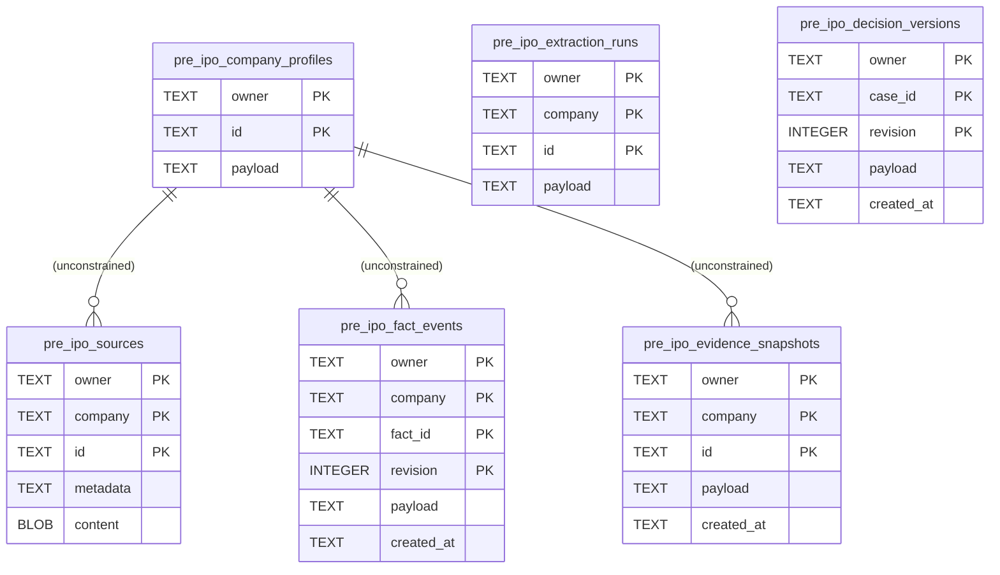
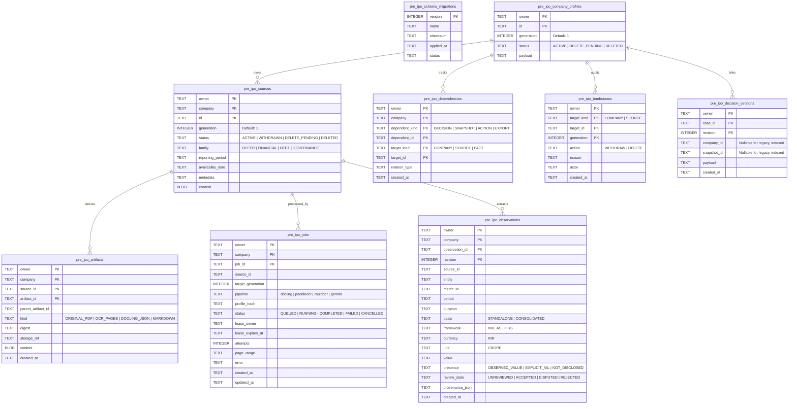

# Pre-IPO Multi-Document Ingestion & Lifecycle: Database Migration Architecture

**Date:** 8 November 2026  
**Status:** Approved for Implementation (Isolated Feature Branch: `feature/pre-ipo-multi-doc-ingestion`)  
**Scope:** Canonical SQLite schema extensions, referential integrity, migration runner, data dictionary, and deletion lifecycle.

---

## 1. Current vs. Proposed Entity-Relationship Diagram (ERD)

### Current Architecture (Legacy Snapshot)

*Deficiencies in Current State:*
1. Zero declared foreign keys or table constraints.
2. No generation counters (`generation`) to reject stale async commits after company deletion.
3. No typed observation index (values trapped in unstructured `payload` JSON).
4. `pre_ipo_decision_versions` has no indexed relationship to `company` or `source`, causing orphaned saved decisions upon deletion.
5. `PRAGMA user_version = 0` with no migration journal or audit tombstones.

---

### Proposed Additive Architecture (v2 Schema)

---

## 2. Data Dictionary

### 2.1 `pre_ipo_schema_migrations`
| Column | Type | Constraints | Description |
|---|---|---|---|
| `version` | INTEGER | PRIMARY KEY | Monotonically increasing migration version (1, 2, ...) |
| `name` | TEXT | NOT NULL | Human-readable migration title |
| `checksum` | TEXT | NOT NULL | SHA256 checksum of the migration SQL/script |
| `applied_at` | TEXT | NOT NULL DEFAULT CURRENT_TIMESTAMP | UTC timestamp when migration finished |
| `status` | TEXT | NOT NULL | State: `APPLIED` or `ROLLED_BACK` |

### 2.2 `pre_ipo_artifacts`
| Column | Type | Constraints | Description |
|---|---|---|---|
| `owner` | TEXT | NOT NULL | Authenticated owner username |
| `company` | TEXT | NOT NULL | Company identifier (e.g. `private-<uuid>`) |
| `source_id` | TEXT | NOT NULL | Associated source PDF ID |
| `artifact_id` | TEXT | NOT NULL | Unique artifact ID (e.g. `art-docling-json-<sha>`) |
| `parent_artifact_id` | TEXT | NULL | Pointer to parent artifact if derived |
| `kind` | TEXT | NOT NULL | `ORIGINAL_PDF`, `DOCLING_JSON`, `OCR_PAGE_IMAGE`, etc. |
| `digest` | TEXT | NOT NULL | SHA-256 hash of content bytes |
| `storage_ref` | TEXT | NULL | External storage URL or path (if offloaded from SQLite) |
| `content` | BLOB | NULL | Inline bytes (for local storage) |
| `created_at` | TEXT | NOT NULL DEFAULT CURRENT_TIMESTAMP | Creation timestamp |

### 2.3 `pre_ipo_jobs`
| Column | Type | Constraints | Description |
|---|---|---|---|
| `owner` | TEXT | NOT NULL | Authenticated owner |
| `company` | TEXT | NOT NULL | Target company ID |
| `job_id` | TEXT | NOT NULL | Unique job ID (UUID) |
| `source_id` | TEXT | NOT NULL | Target document ID |
| `target_generation` | INTEGER | NOT NULL DEFAULT 1 | Company/source generation at job dispatch |
| `pipeline` | TEXT | NOT NULL | Extraction engine name (`docling`, `paddleocr`, etc.) |
| `profile_hash` | TEXT | NOT NULL | Hash of engine options & document metadata |
| `status` | TEXT | NOT NULL | `QUEUED`, `RUNNING`, `COMPLETED`, `FAILED`, `CANCELLED` |
| `lease_owner` | TEXT | NULL | Identifier of the worker process holding lease |
| `lease_expires_at` | TEXT | NULL | Lease expiration ISO timestamp |
| `attempts` | INTEGER | NOT NULL DEFAULT 0 | Retry attempt counter |
| `page_range` | TEXT | NULL | Processed page range, e.g. `1-25` |
| `error` | TEXT | NULL | Error diagnostics if failed |
| `created_at` | TEXT | NOT NULL DEFAULT CURRENT_TIMESTAMP | Job creation time |
| `updated_at` | TEXT | NOT NULL DEFAULT CURRENT_TIMESTAMP | Last state change time |

### 2.4 `pre_ipo_observations`
| Column | Type | Constraints | Description |
|---|---|---|---|
| `owner` | TEXT | NOT NULL | Authenticated owner |
| `company` | TEXT | NOT NULL | Company ID |
| `observation_id` | TEXT | NOT NULL | Unique fact/observation identifier |
| `revision` | INTEGER | NOT NULL DEFAULT 1 | Optimistic revision number |
| `source_id` | TEXT | NOT NULL | Source document ID |
| `entity` | TEXT | NOT NULL | Reporting entity name |
| `metric_id` | TEXT | NOT NULL | Canonical metric key from 74-family register |
| `period` | TEXT | NULL | Fiscal period (e.g. `FY24`, `FY23`) |
| `duration` | TEXT | NULL | Period duration (e.g. `12M`, `6M`) |
| `basis` | TEXT | NULL | `STANDALONE`, `CONSOLIDATED`, `RESTATED` |
| `framework` | TEXT | NULL | `IND_AS`, `IGAAP`, `IFRS` |
| `currency` | TEXT | NULL | `INR`, `USD` |
| `unit` | TEXT | NULL | `CRORE`, `LAKH`, `MILLION` |
| `value` | TEXT | NULL | Extracted raw value string |
| `presence` | TEXT | NOT NULL | `OBSERVED_VALUE`, `EXPLICIT_NIL`, `NOT_DISCLOSED`, etc. |
| `review_state` | TEXT | NOT NULL DEFAULT 'UNREVIEWED' | `UNREVIEWED`, `ACCEPTED`, `DISPUTED`, `REJECTED` |
| `provenance_json` | TEXT | NOT NULL DEFAULT '{}' | Page, bounding box, table cell coordinates |
| `created_at` | TEXT | NOT NULL DEFAULT CURRENT_TIMESTAMP | Creation time |

### 2.5 `pre_ipo_dependencies`
| Column | Type | Constraints | Description |
|---|---|---|---|
| `owner` | TEXT | NOT NULL | Authenticated owner |
| `company` | TEXT | NOT NULL | Company ID |
| `dependent_kind` | TEXT | NOT NULL | `DECISION`, `SNAPSHOT`, `ACTION`, `EXPORT` |
| `dependent_id` | TEXT | NOT NULL | ID of the dependent entity |
| `target_kind` | TEXT | NOT NULL | `COMPANY`, `SOURCE`, `OBSERVATION` |
| `target_id` | TEXT | NOT NULL | ID of the upstream dependency |
| `relation_type` | TEXT | NOT NULL | E.g. `USES_SNAPSHOT`, `USES_SOURCE`, `USES_FACT` |
| `created_at` | TEXT | NOT NULL DEFAULT CURRENT_TIMESTAMP | Dependency registration time |

### 2.6 `pre_ipo_tombstones`
| Column | Type | Constraints | Description |
|---|---|---|---|
| `owner` | TEXT | NOT NULL | Authenticated owner |
| `target_kind` | TEXT | NOT NULL | `COMPANY`, `SOURCE` |
| `target_id` | TEXT | NOT NULL | Deleted entity ID |
| `generation` | INTEGER | NOT NULL | Generation number at deletion |
| `action` | TEXT | NOT NULL | `WITHDRAW`, `DELETE` |
| `reason` | TEXT | NULL | User or system deletion reason |
| `actor` | TEXT | NOT NULL | Authenticated user who performed deletion |
| `created_at` | TEXT | NOT NULL DEFAULT CURRENT_TIMESTAMP | Deletion timestamp |

---

## 3. Versioned Migration Sequence

1. **Migration 001 (`001_baseline_evidence_schema.sql`):**
   - Idempotently verifies existence of original 8 evidence tables.
   - Creates `pre_ipo_schema_migrations` journal table.
   - Records Migration 001 if not present.

2. **Migration 002 (`002_lifecycle_and_multidoc_extensions.sql`):**
   - Adds `generation` (INTEGER DEFAULT 1) and `status` (TEXT DEFAULT 'ACTIVE') to `pre_ipo_company_profiles`.
   - Adds `generation` (INTEGER DEFAULT 1), `status` (TEXT DEFAULT 'ACTIVE'), `family` (TEXT DEFAULT 'OFFER'), `reporting_period` (TEXT), `availability_date` (TEXT) to `pre_ipo_sources`.
   - Creates `pre_ipo_artifacts`, `pre_ipo_jobs`, `pre_ipo_observations`, `pre_ipo_dependencies`, `pre_ipo_tombstones`.
   - Adds `company_id` and `snapshot_id` to `pre_ipo_decision_versions`.
   - Creates performance indexes for lookups, leases, dependencies, and tombstones.

---

## 4. Backfill & Orphan Handling Plan

1. **Company Profiles:**
   - Existing profiles have `status = 'ACTIVE'` and `generation = 1`.
2. **Sources:**
   - Existing sources have `family = 'OFFER'` and `status = 'ACTIVE'`.
   - If `metadata` contains `filing_type` (e.g. "DRHP", "Annual Report"), `family` is inferred.
3. **Fact Events to Observations:**
   - Existing `pre_ipo_fact_events` rows are parsed and projected into `pre_ipo_observations` with `review_state = 'UNREVIEWED'`.
4. **Decision Versions to Dependencies:**
   - Parse `payload` JSON in `pre_ipo_decision_versions`. If `context.company_id` or `context.snapshot_id` exists, populate `company_id`, `snapshot_id`, and register rows in `pre_ipo_dependencies`.
5. **Orphan Rows:**
   - Any fact or snapshot pointing to a non-existent company profile is quarantined in an orphan registry (`pre_ipo_orphans_quarantine`) with timestamp and source hash, never silently deleted or promoted.

---

## 5. Backup, Restore & Rollback Plan

1. **Pre-Migration Backup Rehearsal:**
   - Before running migrations on a database file, the runner uses SQLite Online Backup API (`sqlite3.backup()` or `VACUUM INTO '<db>.bak'`) while holding read lock, ensuring zero corruption from active WAL transactions.
2. **Rollback Rehearsal:**
   - Down migrations reverse additive columns/tables. If rolled back, data in new additive tables is archived into `<db>_rollback_archive.db` before table drops.
3. **Durability Decision:**
   - SQLite WAL mode with `PRAGMA synchronous = NORMAL` and `PRAGMA busy_timeout = 5000` provides ACID compliance.
   - Stored original PDF bytes remain directly in `pre_ipo_sources` (blobs up to 25MB). Artifact derivatives (Docling JSON, OCR text) reside in `pre_ipo_artifacts`.
