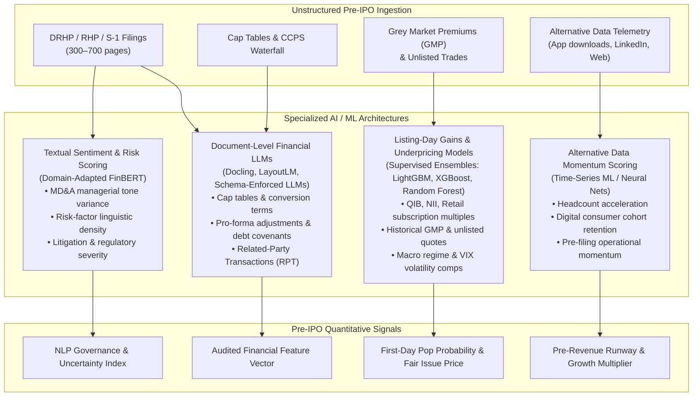
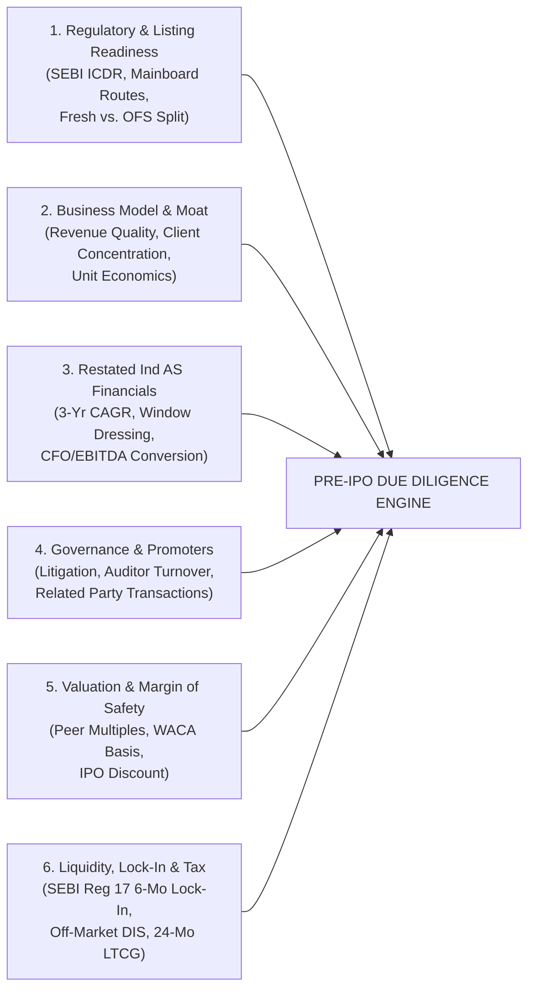

# Pre-IPO Intelligence: Comprehensive Foundations, AI/ML Landscape, Institutional Frameworks & Architectural Blueprint

**Document Class:** Institutional Research, Brainstorming & Architecture Blueprint  
**Target System:** `ProfSurProject` — LifeCycle Leverage Intelligence Platform  
**Date:** November 2026  
**Status:** Living Master Context & Reference Document  

---

## Executive Summary: The Pre-IPO Intelligence Frontier

There is **no single, universally standard standalone financial model** (in the sense of a pretrained, turnkey foundation model like BloombergGPT or FinGPT) purpose-built solely for pre-IPO intelligence. 

Because private and late-stage pre-IPO firms suffer from severe information asymmetry and lack continuous, order-book public price discovery, a turnkey model cannot resolve the multi-faceted problem of pricing, governance, and structural risk. Instead, the global and Indian pre-IPO intelligence landscape breaks down into two distinct categories:

1. **Specialized AI/Machine Learning Architectures** designed to ingest, structure, and analyze unstructured statutory filings (DRHP, RHP, S-1), cap tables, and alternative market data signals.
2. **Deterministic Quantitative & Econometric Valuation Frameworks** adapted specifically for late-stage private companies transitioning to public markets (capital structure waterfalls, step-down WACC dynamics, working capital runway, Dickinson life-cycle stage modeling, and Ind AS restatement analysis).

This document establishes the permanent theoretical, empirical, regulatory, and software architecture foundations for pre-IPO evaluation in `ProfSurProject`. It aggregates core research, integrates the complete practitioner blueprint for Indian primary markets (**SEBI ICDR 2018**, **CRISIL IPO Grading**, **JRFM 2023**, **SJMSOM IIT Bombay ML research**), and defines the evolutionary roadmap for our Pre-IPO intelligence engine.

---

## Section 1: AI & Machine Learning Architectures for Pre-IPO Intelligence

Because private and late-stage pre-IPO firms lack continuous public market price discovery, AI models in this space focus on four distinct analytical tasks:



### 1.1 S-1 / DRHP Parsing & Financial Extraction (Document-Level LLMs)
- **Challenge:** Statutory prospectuses are massive (300 to 700+ pages), dense, multi-column documents combining audited tables, scanned legal schedules, complex footnotes, and qualitative risk disclosures. Standard 10-K parsers fail because pre-IPO documents embed non-standardized Ind AS restatement schedules, pro-forma adjustments, and historical stub periods.
- **Architectural Approach:** Specialized financial benchmark agent frameworks leverage layout-aware multimodal pipelines (e.g., Docling, Azure Document Intelligence, LlamaParse) combined with schema-enforced long-context LLMs.
- **Target Extraction Entities:**
  - Cap tables and share capital structures (authorized vs. issued vs. fully diluted).
  - Convertibles: Compulsorily Convertible Preference Shares (CCPS), Optionally Convertible Debentures (OCDs), and employee stock option plans (ESOPs).
  - Related-Party Transactions (RPTs) spanning promoter entities, loans, brand royalties, and lease agreements.
  - Debt perimeter: Funded term loans, working capital facilities, external commercial borrowings (ECBs), and operating lease liabilities under Ind AS 116.
  - Contingent liabilities and litigations across criminal, tax, regulatory (SEBI/RBI), and material civil domains.

### 1.2 Listing-Day Gains & Underpricing Prediction (Supervised Ensembles)
- **Challenge:** Underpricing (the "first-day pop") and listing-day volatility are driven by a complex interplay of fundamental quality, pricing discount, institutional sentiment, and retail frenzy.
- **Architectural Approach:** Academic and quant hedge fund models deploy supervised ensemble architectures—primarily **XGBoost**, **LightGBM**, and **Random Forests**—trained on historical pre-IPO feature sets.
- **Key Feature Taxonomy:**
  - *Quantitative Subscription Multiples:* Institutional (QIB), High Net-Worth Individuals (NII/HNI), and Retail individual bidding rates across the 3-day window.
  - *Anchor Investor Tiering:* Ratio of marquee domestic mutual funds and sovereign wealth funds versus foreign portfolio investors (FPIs).
  - *Pre-Issue Pricing Anchors:* Grey Market Premiums (GMP), unlisted secondary trades (from platforms like Forge Global, CartaX, Caplight, or Indian unlisted brokers), and Weighted Average Cost of Acquisition (WACA).
  - *Market Climate Factors:* Volatility Index (India VIX), 30-day market returns, benchmark 10-year G-Sec yields, and sector-specific valuation multiple momentum.

### 1.3 Sentiment & Risk Analysis (NLP / FinBERT Variants)
- **Challenge:** Prospectuses contain hundreds of boilerplate risk disclosures designed by legal counsel to protect issuers from liability. The challenge is distinguishing generic boilerplate from genuine operational and governance risks.
- **Architectural Approach:** Domain-adapted transformer models (FinBERT, RoBERTa fine-tuned on financial filings) process the "Management Discussion and Analysis" (MD&A) and "Risk Factors" chapters:
  - *Linguistic Tone Variance:* Quantifies optimism vs. pessimism, modal ambiguity, and hedge words.
  - *Risk-Factor Density & Novelty:* Measures the semantic similarity of risk factor text against standard sector templates; high semantic deviation signals company-specific vulnerabilities.
  - *Litigation Exposure Index:* Aggregates the cumulative monetary claims in outstanding litigations normalized by issuer net worth.

### 1.4 Alternative Data Scoring
- **Challenge:** Pre-IPO companies in digital and platform sectors often report negative accounting profits. Valuation hinges on user engagement and market share gains.
- **Architectural Approach:** Quantitative models utilized by crossover hedge funds (Coatue, Tiger Global) and VC allocators ingest operational telemetry:
  - App downloads, active daily users (DAU/MAU), and app store review ratings.
  - Hiring velocity and specialized engineering headcount growth tracked via LinkedIn talent data.
  - Web domain traffic, bounce rates, and organic search volume via web intelligence feeds.
  - Developer engagement (GitHub commits, API documentation activity) for B2B/SaaS technology issuers.

---

## Section 2: Traditional Quantitative & Econometric Pre-IPO Models

In investment banking, equity research, and private equity, pre-IPO modeling relies on deterministic financial models adjusted for the unique characteristics of private-to-public transitions:

| Model Architecture | Pre-IPO Focus & Critical Structural Adjustments |
|---|---|
| **Consensus & Peer Comps (Trading Multiples)** | Adjusts for the statutory **"IPO Discount"** (typically 10%–20% below trading multiples of public peers to ensure an oversubscribed book-building process and first-day pop). Neutralizes differences in capital structure using EV/EBITDA. |
| **Capital Structure & Dilution Waterfall** | Models conversion mechanics: Preferred Stock to Common Stock conversions, SAFE/convertible note settlements, employee option pool expansion prior to pricing, promoter share lock-in, and Greenshoe (over-allotment) exercise scenarios. |
| **Discounted Cash Flow (DCF)** | Deploys scenario-weighted cash flows and **step-down WACC curves**: higher initial discount rates prior to listing (reflecting private firm illiquidity and execution risk) that step down post-IPO as liquidity risk declines and access to capital markets expands. |
| **Working Capital & Liquidity Runway** | Models monthly cash burn rates to verify post-issue working capital sufficiency (statutorily required by listing regulations, such as 18–24 months of verified operating runway). |
| **Dickinson (2011) Life-Cycle Stage Mapping** | Evaluates Cash Flow from Operations (CFO), Investing (CFI), and Financing (CFF) sign vectors to classify the issuer into Introduction, Growth, Mature, Shake-Out, or Decline stages, determining sustainable leverage capacity. |

---

## Section 3: Commercial Pre-IPO Intelligence Platforms Landscape

Several commercial platforms combine quantitative modeling and machine learning specifically for late-stage and pre-IPO assets:

* **InSync Analytics:** Delivers pre-built, forward-looking pre-IPO financial models, segment KPIs, and peer comps directly integrated into analyst workflows for imminent listings.
* **PitchBook & CB Insights:** Deploy proprietary scoring algorithms (e.g., CB Insights' *Mosaic* algorithm) that predict exit likelihood, IPO timing, and implied valuation based on syndicate quality, financial health, and industry momentum.
* **Forge Global / Caplight / CartaX:** Aggregate secondary market transaction pricing, synthetic forward curves, and liquidity discounts for late-stage unicorns preparing for statutory filings.
* **Indian Primary Market Data Portals (NSE, BSE, Chittorgarh, IPO Watch, Ace Equity, CMIE Prowess):** Provide live bidding subscription rates across QIB/NII/Retail buckets, Grey Market Premiums, anchor allocation sheets, and historical Ind AS restatement databases.

---

## Section 4: Indian Pre-IPO Analysis Framework (Six-Pillar Methodology)

*(Exhaustive integration from `Pre-IPO-Analysis-Framework-and-App-Blueprint-India.pdf`)*

A pre-IPO analysis framework in India evaluates an unlisted company's business fundamentals, corporate governance, valuation, and regulatory readiness prior to listing on the National Stock Exchange (NSE) or BSE. Whether an investor is acquiring unlisted shares in the off-market or evaluating an upcoming public issue via its Draft Red Herring Prospectus (DRHP), institutional due diligence relies on six core pillars:



### Pillar 1: Regulatory & Listing Readiness
Before analyzing financial multiples, practitioners verify how close the issuer is to a public listing under the SEBI (Issue of Capital and Disclosure Requirements) [ICDR] Regulations:
- **Filing Status:** Verify whether the company has filed a DRHP on the SEBI Filings Portal. Acquiring unlisted shares prior to a DRHP filing carries substantial timeline and liquidity risk, as there is no statutory obligation for a private company to complete a listing.
- **Mainboard Eligibility Routes:** 
  - *Standard Profitability Route:* Requires at least ₹3 crore in net tangible assets in each of the preceding three full years and ₹15 crore in average pre-tax operating profit in at least three of the preceding five years.
  - *QIB / Alternative Route:* Designed for loss-making, high-growth technology enterprises, requiring at least 75% allocation to Qualified Institutional Buyers (QIBs).
- **Objects of the Issue (Fresh Issue vs. OFS):** Separate capital raised via a **Fresh Issue** (proceeds enter the company's balance sheet for capacity expansion, working capital, or debt reduction) from an **Offer for Sale (OFS)** (proceeds go to exiting private equity investors or promoters). A predominantly OFS issue with minimal growth capital requires scrutiny of insider exit motivations.

### Pillar 2: Business Model & Competitive Moat
- **Revenue Quality & Concentration:** Distinguish recurring, contract-backed revenue from one-off windfalls. Examine top-5 and top-10 customer and supplier concentration tables in the DRHP; dependence on a narrow client base exposes post-listing earnings to sudden shocks.
- **Unit Economics & Scalability:** Assess whether contribution margins expand alongside top-line growth. For consumer-facing and digital platforms, track Customer Acquisition Cost (CAC) trends relative to Customer Lifetime Value (LTV) and cohort retention.
- **Industry Tailwinds & Defensibility:** Benchmark market share, distribution reach, intellectual property, and customer switching costs against established listed peers.

### Pillar 3: Restated Financial Health (3-Year Track Record)
Indian issuers must present three full financial years (plus any applicable stub period) of restated financial statements prepared under Indian Accounting Standards (Ind AS). Emphasis must be placed on cash generation rather than accrual accounting profits:
- **Earnings Trajectory & Window Dressing Check:** Analyze 3-year Compound Annual Growth Rates (CAGR) across Revenue, EBITDA, and Profit After Tax (PAT). Flag abrupt margin spikes in the final pre-DRHP fiscal year or stub period, which frequently reflect temporary cuts in marketing, R&D, or employee expenses.
- **Cash Flow Conversion:** Compare Cash Flow from Operations (CFO) against EBITDA and PAT. Consistent accounting profits paired with weak or negative CFO indicate working capital stress, ballooning trade receivables, or aggressive revenue recognition.
- **Leverage & Capital Efficiency Ratios:** Evaluate Debt-to-Equity, Interest Coverage Ratio (ICR), Return on Equity (ROE), and Return on Capital Employed (ROCE) to determine how efficiently management deploys capital.

### Pillar 4: Governance, Promoters & Red Flags
- **Promoter Track Record & Litigation:** Inspect the *"Promoters and Promoter Group"* and *"Outstanding Litigation and Material Developments"* chapters of the DRHP for criminal proceedings, SEBI/RBI regulatory actions, tax disputes, or frequent statutory auditor resignations over the preceding three years.
- **Related Party Transactions (RPTs):** Scrutinize loans, advances, brand royalties, leases, and procurement contracts involving promoter-owned entities. High RPT volumes relative to revenue or net worth signal potential value leakage.
- **Cap Table Cleanliness:** Verify that complex instruments—such as Optionally Convertible Debentures (OCDs), Compulsorily Convertible Preference Shares (CCPS), and special shareholder veto rights—are converted or terminated prior to Red Herring Prospectus (RHP) filing.

### Pillar 5: Valuation & Margin of Safety
Unlisted share prices are formed through negotiated bilateral trades rather than transparent order-book discovery, often embedding optimistic premiums. Practitioners benchmark implied issue valuations against listed peers across four core multiples:

| Valuation Metric | Primary Applicability | Practitioner Benchmark Check |
|---|---|---|
| **P/E Ratio (Price-to-Earnings)** | Profitable, mature manufacturing, financial, and service businesses | Compare implied post-issue P/E (at upper price band) against listed peers' trailing 12-month and forward P/E. |
| **EV / EBITDA** | Capital-intensive, asset-heavy, or leveraged companies | Neutralizes capital structure and depreciation differences across comparable listed firms. |
| **Price-to-Sales (P/S)** | High-growth, pre-profit startups and digital platforms | Evaluate alongside gross margin profile, unit economics, and realistic timeline to EBITDA break-even. |
| **Last Round Valuation (WACA)** | Secondary pre-IPO unlisted share purchases | Compare current grey/unlisted quote against the Weighted Average Cost of Acquisition (WACA) disclosed in the DRHP. |

### Pillar 6: Liquidity, Lock-In & Tax Rules (Unlisted Market Buyers)
When advising clients purchasing shares in the pre-IPO unlisted market rather than bidding in the public IPO, structural regulatory constraints apply:
- **Mandatory 6-Month Post-Listing Lock-In:** Under Regulation 17 of SEBI (ICDR) Regulations, the entire pre-issue capital held by non-promoters is locked in for **6 months** from the date of IPO allotment. Unlisted buyers cannot exit on listing day to capture a listing pop; the investment thesis must remain viable six months post-listing.
- **Settlement & Counterparty Risk:** Off-market transfers occur via Delivery Instruction Slips (DIS) or electronic CDSL/NSDL off-market transfer modules rather than exchange clearing corporations. Counterparty verification and escrow/simultaneous settlement protocols are essential.
- **Capital Gains & Valuation Tax Rules:** Unlisted equity shares require a **24-month holding period** to qualify for Long-Term Capital Gains (LTCG) tax treatment (compared to 12 months for listed equities). Additionally, acquisitions below prescribed Fair Market Value (FMV) attract taxation under Section 56(2)(x) of the Income Tax Act.

---

### Practical Application Example: Evaluating a Pre-IPO Issue
> **Case Study (from Blueprint):**  
> Consider a consumer manufacturing firm filing a ₹1,200 crore DRHP structured as ₹300 crore Fresh Issue and ₹900 crore Offer for Sale (**75% OFS**).  
> - 3-year Revenue CAGR is 22%.  
> - PAT margin jumped from 6% in FY23 to 14% in FY25.  
> - **However:** CFO/EBITDA dropped from $0.85\times$ to $0.35\times$ due to rising trade receivables.  
> - Implied upper-band P/E is $58\times$ versus a listed peer average of $36\times$.  
> 
> *Diagnosis:* Under this framework, the heavy OFS (75%), deteriorating cash conversion, and 61% valuation premium trigger critical governance and pricing red flags—especially for unlisted buyers bound by the mandatory 6-month SEBI lock-in.

---

## Section 5: Application Blueprint for Financial Practitioners

To operationalize this framework for Registered Investment Advisers (RIAs), Research Analysts (RAs), and portfolio managers in India, an IPO evaluation application must bridge unstructured statutory filings (DRHP/RHP) with automated quantitative scoring, peer benchmarking, and compliance-ready advisory workflows.

### 5.1 Core Application Modules
1. **DRHP / RHP Ingestion & Structured Extraction:** Upload DRHP/RHP PDF or ingest directly from SEBI feeds. Layout-aware parsing extracts 3-year Restated Financial Statements, Objects of the Issue (Fresh vs. OFS split), statutory KPIs, Outstanding Litigations, Contingent Liabilities, and Related Party Transactions—attaching exact page-number citations to every data point.
2. **Quantitative Scoring Engine:** Calculates normalized sub-scores across Growth (Revenue/PAT CAGR), Profitability (EBITDA/PAT margins, ROE, ROCE, ROA), and Cash Quality (CFO-to-EBITDA). Implements automated anomaly triggers for stub-period margin expansion, rising receivable days, or auditor turnover.
3. **Peer Benchmarking & Valuation Matrix:** Connects to Indian market data feeds (NSE/BSE, CMIE Prowess, Ace Equity) to pull live valuation multiples (P/E, EV/EBITDA, P/B, P/S) for comparable listed companies. Computes implied post-issue market capitalization and multiples across lower and upper price bands, displaying the percentage discount or premium against peer medians.
4. **Guidance & Compliance-Aligned Output Generator:** Synthesizes quantitative scores and qualitative red flags into structured practitioner memos. Depending on the practitioner's regulatory license (e.g., SEBI RA vs. analytical decision-support platform), generates either explicit recommendations (Subscribe for Long Term, Subscribe for Listing Gains, Avoid) or objective risk-return scorecards with standardized SEBI risk disclaimers.

### 5.2 Differentiating Features for Indian Primary Markets
1. **Anchor Book & Live Subscription Tracker:** Tracks real-time QIB, Non-Institutional Investor (NII/HNI), and Retail subscription multiples across the 3-day bidding window, paired with an Anchor Investor quality tiering engine (distinguishing marquee domestic mutual funds and sovereign wealth funds from opaque FPIs).
2. **Pre-IPO vs. IPO Arbitrage & Lock-In Calculator:** Models the true break-even listing price for unlisted market buyers by incorporating off-market acquisition premiums, stamp duty/brokerage, the mandatory 6-month SEBI ICDR lock-in holding period, and unlisted capital gains tax differentials.
3. **Automated DRHP Red-Flag Scanner:** Runs targeted NLP checks across Risk Factors, Litigations, and Restated Financials sections to surface statutory auditor resignations, contingent liabilities exceeding 15% of net worth, promoter share pledges, and regulatory show-cause notices.

### 5.3 Suggested Tech Stack & Data Architecture

| Architectural Layer | Recommended Technologies | Functional Purpose |
|---|---|---|
| **Document Parsing & AI Extraction** | Layout-aware PDF parsers (Docling, LlamaParse, Azure Document Intelligence) + Schema-enforced LLMs | Accurate extraction of multi-page Ind AS financial tables and KPIs with verifiable page citations. |
| **Financial & Market Data Feeds** | NSE/BSE corporate feeds, CMIE Prowess, Ace Equity, or market data APIs | Live listed peer multiples, sector benchmarks, and historical post-listing performance tracking. |
| **Quantitative & NLP Scoring Engine** | Python (Pandas, Scikit-learn, LightGBM/XGBoost) + FinBERT / domain embeddings | Multi-factor scoring, anomaly detection, and prospectus textual risk/uncertainty scoring. |
| **Compliance & Audit Trail** | PostgreSQL / SQLite immutable audit logs, versioned report templates, PDF/DOCX/PPTX export engine | Maintains SEBI audit trails, timestamped thesis versions, and exportable client research memos. |

---

## Section 6: Institutional Frameworks & Academic Literature

The scoring weights, feature selection, and dual-score design of the application are grounded in established Indian regulatory grading frameworks and peer-reviewed empirical research on NSE and BSE listings:

### 6.1 Institutional & Regulatory Frameworks (India-Specific)
- **CRISIL / ICRA IPO Grading Methodology:** Introduced under SEBI's framework in 2007 (made optional in 2014), CRISIL's IPO Grading Methodology remains the benchmark practitioner scorecard in India. It evaluates issuers on a 1-to-5 scale across four pillars: **Business Prospects**, **Financial Position**, **Management Capabilities**, and **Corporate Governance**. Crucially, it separates fundamental business quality from issue pricing—a structural separation the application must preserve.
- **SEBI Statutory KPI Disclosure Framework (ICDR Amendments):** SEBI mandates that loss-making and new-age issuers disclose audited Key Performance Indicators (KPIs) in the *"Basis for Issue Price"* chapter of the DRHP, alongside Weighted Average Cost of Acquisition (WACA) across past private funding rounds. Parsing this mandatory table provides a regulator-audited valuation anchor.

### 6.2 Peer-Reviewed Academic Studies on Indian IPOs
- **Pre-IPO Financial Performance & Offer Price Estimation (JRFM, 2023):** Empirical analysis of Indian IPOs demonstrates that four financial metrics exhibit the highest combined explanatory power for justifying IPO offer prices: **Net Asset Value (NAV)**, **Return on Assets (ROA)**, **Profit After Tax (PAT)**, and **Return on Net Worth (RONW)**.
- **Systematic Literature Review of Indian IPOs (2023):** A PRISMA systematic review synthesizing 111 studies on the Indian primary market establishes that while agency signals (promoter dilution, Fresh Issue vs. OFS split) and institutional demand (QIB/Anchor subscription) drive short-term listing pops, corporate governance quality and pre-IPO earnings management (artificial margin inflation prior to filing) are the strongest predictors of long-run post-listing underperformance.
- **Efficacy of IPO Grading on Long-Run Operating Performance (EELET, IJF):** Studies evaluating graded Indian IPOs show that structured fundamental grading correlates significantly with lower post-listing return volatility and superior industry-adjusted operating performance (PBDITA/Total Assets), even though fundamental grades alone do not predict day-one listing gains.

### 6.3 Machine Learning & Prospectus NLP Research
- **ML Prediction of Indian IPO Underperformance (SJMSOM, IIT Bombay):** Research comparing ensemble machine learning models (Gradient Boosting, Random Forest) against traditional regressions on Indian listings confirms that **Gradient Boosting** significantly improves underperformance prediction, identifying profit margins, debt-to-assets ratio, and prevailing market sentiment as top predictive features.
- **Automated RHP Rating & Textual Uncertainty Models (SSRN):** Quantitative NLP studies analyzing Red Herring Prospectuses demonstrate that linguistic tone, risk-factor density, and litigation disclosure complexity significantly explain valuation uncertainty and improve abnormal return forecasts compared to financial ratios alone.

---

## Section 7: The Recommended Dual-Score Architecture

Based on the consensus across Indian IPO literature, an institutional application must avoid blending fundamentals and market hype into a single opaque number. Instead, it computes **two independent, transparent scores**:

```text
                                  ┌──────────────────────────────────────────────┐
                                  │          PRE-IPO EVALUATION ENGINE           │
                                  └──────────────────────┬───────────────────────┘
                                                         │
                         ┌───────────────────────────────┴───────────────────────────────┐
                         ▼                                                               ▼
        ┌──────────────────────────────────┐                            ┌──────────────────────────────────┐
        │  SCORE 1: FUNDAMENTAL QUALITY    │                            │    SCORE 2: PRICING & SENTIMENT  │
        │    (Long-Term Hold Signal)       │                            │      (Listing Gain Signal)       │
        └────────────────┬─────────────────┘                            └────────────────┬─────────────────┘
                         │                                                               │
        • Return on Net Worth (RONW)                                    • Peer Multiple Discount (P/E, EV/EBITDA)
        • Return on Assets (ROA)                                        • Fresh Issue vs. OFS Capital Split
        • CFO-to-EBITDA Cash Conversion                                 • Anchor Investor Tiering (MFs/SWFs vs. FPIs)
        • Debt-to-Assets & Ind AS 116 Perimeter                         • QIB / NII Live Subscription Multiples
        • Window-Dressing & Accrual Check                               • Grey Market Premium (GMP) Dynamics
        • NLP Risk-Factor & Litigation Density                          • WACA Ratio vs. Upper Price Band
```

1. **Fundamental & Governance Score (Long-Term Hold Signal):** Weighted toward RONW, ROA, CFO-to-EBITDA conversion, Debt-to-Assets, and NLP red-flag scans of Risk Factors and Litigations (grounded in CRISIL methodology, JRFM 2023, and IIT Bombay ML findings).
2. **Pricing & Sentiment Score (Listing Gain Signal):** Weighted toward peer P/E or EV/EBITDA discount, Fresh Issue vs. OFS ratio, Anchor Investor quality, and live QIB/NII subscription multiples (grounded in Indian IPO underpricing literature).

---

## Section 8: Comprehensive Academic & Statutory Reference List

1. **Securities and Exchange Board of India (SEBI).** *SEBI (Issue of Capital and Disclosure Requirements) Regulations, 2018 (as amended) & DRHP Public Filings Portal.*  
   [SEBI Filings Portal](https://www.sebi.gov.in/sebiweb/home/HomeAction.do?doListing=yes&sid=3&ssid=15&smid=10)
2. **National Stock Exchange of India (NSE) & BSE India.** *Primary Market IPO Bidding, Anchor Allocation, and Listed Peer Valuation Data Portals.*  
   [NSE India](https://www.nseindia.com/) • [BSE India](https://www.bseindia.com/)
3. **CRISIL Ratings / CRISIL Research.** *CRISIL IPO Grading Methodology: Framework for Assessing Business Prospects, Financial Position, Management Capabilities, and Corporate Governance.*  
   [CRISIL Research IPO Grading](https://www.crisilratings.com/content/dam/crisil/our-businesses/capital-markets/ipo-grading-list/company-name/CRISIL-Research-IPO-grading.html)
4. **Journal of Risk and Financial Management (MDPI, 2023).** *Pre-IPO Financial Performance and Offer Price Estimation: Evidence from India.* Volume 16, Issue 2, Article 135.  
   [MDPI JRFM 2023 Article](https://www.mdpi.com/1911-8074/16/2/135)
5. **Systematic Review on Indian Primary Markets (2023).** *Studies on Indian IPO: Systematic Review and Future Research Agenda* (PRISMA synthesis of 111 empirical studies on Indian IPO underpricing, governance, and long-run performance).  
   [ResearchGate Publication 373948198](https://www.researchgate.net/publication/373948198_Studies_on_Indian_IPO_systematic_review_and_future_research_agenda)
6. **Indian Journal of Finance.** *Grading and Risk-Adjusted Performance of Indian IPOs* (Empirical evaluation of IPO grading impact on post-listing volatility and risk-adjusted returns).  
   [Indian Journal of Finance](https://indianjournaloffinance.co.in/article/grading-and-risk-adjusted-performance-of-indian-ipos/)
7. **European Economic Letters (EELET).** *Does IPO Grading Convey Future Performance? Evidence from Indian IPOs* (Analysis of PBDITA/Total Assets and industry-adjusted operating performance).  
   [EELET Article 3354](https://www.eelet.org.uk/index.php/journal/article/view/3354)
8. **Agrawal, S. & Ananthakumar, U. (SJMSOM, IIT Bombay).** *Predicting IPO Underperformance in Indian Markets Using Machine Learning Techniques* (Comparative evaluation of Gradient Boosting, Random Forest, and financial/sentiment predictors).  
   [Scribd Document 757005109](https://www.scribd.com/document/757005109/Predicting-IPO-underperformance-using-machine-learning)
9. **SSRN Working Paper Series.** *Predicting Ratings of Indian IPOs from Red Herring Prospectus* (Automated textual and quantitative modeling of Indian RHP disclosures).  
   [SSRN Abstract 5217693](https://papers.ssrn.com/sol3/Delivery.cfm/5217693.pdf?abstractid=5217693&mirid=1&type=2)
10. **SSRN Working Paper Series.** *Textual Information and IPO Underpricing: A Machine Learning Approach* (NLP-based measurement of prospectus uncertainty, tone, and abnormal returns).  
    [SSRN Abstract 4963076](https://papers.ssrn.com/sol3/papers.cfm?abstract_id=4963076)

---

## Section 9: Integration Blueprint for `ProfSurProject`

To extend `ProfSurProject` from its current verified baseline (513-page HCCH DRHP vertical slice, Ind AS restatements, Dickinson life-cycle mapping, immutable evidence snapshots, and SEBI Reg 26(1) valuation circuit breakers), we map the implementation into clean, test-driven Python modules:

```text
ProfSurProject/
├── models/
│   ├── pre_ipo_dossier_adapter.py        # [Existing] Typed dossier & canonical hash verification
│   ├── pre_ipo_capability_gate.py        # [Existing] Dual-mode gate & Reg 26(1) circuit breaker
│   ├── pre_ipo_dual_score_engine.py      # [NEW] Fundamental (CRISIL) & Pricing/Sentiment Scores
│   ├── pre_ipo_anomaly_scanner.py        # [NEW] Window-dressing, CFO/EBITDA & accruals detector
│   ├── pre_ipo_objects_route_scanner.py  # [NEW] Fresh vs. OFS split & SEBI profitability route
│   ├── pre_ipo_lockin_arbitrage.py       # [NEW] Reg 17 6-month lock-in & unlisted LTCG tax model
│   └── pre_ipo_waca_peer_matrix.py       # [NEW] Basis for Issue Price WACA & CMIE peer comps
└── pages/
    └── 27_pre_ipo_drhp.py                # [Existing/Extended] Institutional Due Diligence Tabs
```

This ensures full continuity with our existing immutable database constraints, 4-profile RBAC model, and Cloud Run zero-traffic deployment standards.
